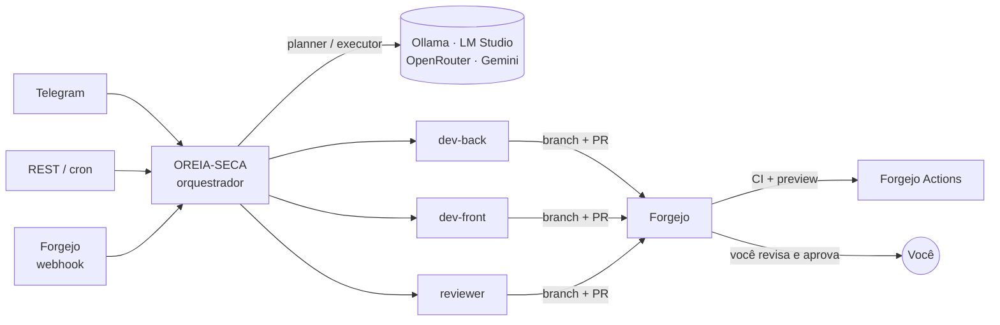

#  O.R.E.I.A.S.E.C.A

**Orquestrador de Recursos e Experimentos em IA para Sistemas de Execução e Controle Automatizado**
Orquestrador de agentes de IA que trabalham como um time de devs, em Rust.
Cada agente é uma conta no seu Forgejo: pega uma issue, trabalha num branch,
abre o pull request e espera **você** aprovar. Você acompanha e decide pelo
Telegram. O LLM é sempre externo (outra máquina, LM Studio, OpenRouter...) —
veja [Modelos locais](docs/modelos-locais.md).

roteador de modelos por papel, a fila de tarefas, a aprovação humana
cross-canal e as skills, e acrescenta o ciclo issue → PR no Forgejo.



## Como funciona, em uma issue

1. Você cria uma issue no Forgejo com a label `agent:back`.
2. O Forgejo avisa o OREIA (webhook assinado). No Telegram aparece: *"Issue #12 atribuída a dev-back"*.
3. O modelo **planner** quebra a issue em fases; o agente clona o repositório num branch `agent/dev-back/issue-12`.
4. O modelo do agente executa as fases: lê código, escreve arquivos, roda testes (ações `shell`, `file_read`, `file_write` e skills).
5. O OREIA faz commit e push **com a conta do agente** e abre o PR com `Closes #12`.
6. O CI roda; você revisa (no Forgejo ou no [px0](https://github.com/px0-ai/px0)) e responde pelo Telegram:
   `/merge 7` para integrar, ou `/changes 7 faltou validar o e-mail` para o agente voltar ao PR.

O `main` fica protegido: agente nenhum faz push direto, e o merge exige a sua aprovação.

## Começando

Requisitos: Docker com Compose e bash 4+ (Linux, Mac, WSL ou Git Bash no
Windows). `make` é opcional — sem ele, use `./oreia <comando>` no lugar de
`make <comando>` (mesmos comandos; veja [Instalação](docs/instalacao.md)).
`setup`, `check`, `build`, `test`, `lint` e `fmt` também precisam de `cargo`.

```bash
make setup                # configuração inicial: Telegram, LLM externo e (se você disser que
                          # sim) o bootstrap do Forgejo — make setup-answers para
                          # automatizar/deixar um agente de IA fazer
make bootstrap            # só se não tiver rodado pelo "make setup": cria os usuários, tokens,
                          # repositório, labels e webhook no Forgejo
make up                   # sobe Forgejo e o OREIA-SECA
make status               # containers + health check (ou "make logs" para acompanhar)
```

Sem `make`? É `./oreia setup`, `./oreia bootstrap`, `./oreia up`, `./oreia status`.

Abra `http://localhost:3000` (usuário e senha estão no `.env`), crie uma issue com a
label `agent:back` em `minha-org/meu-sistema` e acompanhe pelo Telegram.

> Não sabe seu ID do Telegram? Mande qualquer mensagem ao bot: ele responde com o ID para você colocar em `TELEGRAM_ALLOWED`.
> Porta 3000, 2222 ou 3120 já ocupada por outra coisa nessa máquina? Mude
> `FORGEJO_HTTP_PORT`/`FORGEJO_SSH_PORT`/`OREIA_SECA_PORT` no `.env` — `make bootstrap`/`./oreia bootstrap` e `make up`/`./oreia up` avisam antes de tentar, em vez de só o Docker falhar com um erro cru.

## Comandos (Telegram, terminal ou `POST /api/message`)

| Comando | O que faz |
|---|---|
| texto livre | conversa direta, ou vira tarefa planejada se for um pedido de construção |
| `/feature <descrição>` | cria uma tarefa sem passar pelo classificador |
| `/issue [dono/repo] <título>` | abre uma issue no Forgejo (passo a passo se vier sem nada) |
| `/assign [dono/repo] <n> <agente>` | atribui uma issue aberta a um agente |
| `/status` · `/queue` · `/tasks` | fila, tarefas em execução e suas últimas tarefas |
| `/approve <id>` · `/reject <id>` · `/pending` | aprovação de tarefas vindas de REST/cron |
| `/retry <id>` | retoma uma tarefa interrompida |
| `/prs` | PRs abertos aguardando você |
| `/merge [dono/repo] <n>` | aprova e integra o PR |
| `/changes [dono/repo] <n> <texto>` | pede ajustes e coloca o agente de volta no PR |
| `/models` · `/agents` | modelo ativo por papel e estado dos agentes |
| `/check` | checa modelos, executores, Forgejo, tokens e Telegram da config atual |
| `/stats [papel]` | estatísticas de escalada: degraus, custo total e médio |
| `/skills [reload]` | ações disponíveis; recarrega as skills sem reiniciar |
| `/resumir` · `/limpar` | compacta ou apaga o histórico da conversa |

No Forgejo, comentar `@agent-back <pedido>` numa issue ou num PR do agente também o faz voltar ao trabalho.

## Estrutura

```
crates/
  oreia-core/      tarefas, fila, aprovação, classificador, parser de <action>, skills, armazenamento
  oreia-llm/       provedor OpenAI-compatível + roteador por papel com reserva e cooldown
  oreia-forgejo/   cliente da API e webhooks (assinatura HMAC)
  oreia-channels/  Telegram (long polling, sem framework) e terminal
  oreia-seca/      binário: config, planner, executor/escalada, git, HTTP, comandos
agents/            instruções de cada agente (AGENT.md)
skills/            skills em Markdown com bloco ```sh
scripts/           bootstrap do Forgejo
templates/app-repo CI e preview para o repositório do SEU sistema
docs/              arquitetura, configuração, agentes, segurança, modelos locais, roadmap
```

## Desenvolvimento

```bash
cargo test --workspace      # 100 testes, incluindo issue → PR, escalada e os três modos de setup com Forgejo simulado e git real
make lint                   # fmt + clippy -D warnings
cargo run -p oreia-seca -- --check --config oreia-seca.example.toml
```

## Documentação

- [Instalação](docs/instalacao.md): as três formas de rodar o setup inicial (terminal, página web, arquivo de respostas) e como automatizar com um agente de IA
- [Arquitetura](docs/arquitetura.md): componentes e o caminho de uma mensagem
- [Configuração](docs/configuracao.md): `oreia-seca.toml` e `.env` campo a campo
- [Agentes](docs/agentes.md): como criar um agente novo e como eles se coordenam
- [Executores e escalada](docs/executores.md): `builtin` vs. CLIs externas e a escada de escalada por papel
- [Modelos locais](docs/modelos-locais.md): Ollama, LM Studio, llama.cpp e estratégia híbrida
- [Benchmark de hardware](docs/benchmark.md): mede CPU/RAM reais com `docker stats` em repouso e durante tarefas, cruzando com `data/escalation.jsonl`
- [px0 (revisão de PR)](docs/px0.md): abra `localhost:7777`, entre com login único via Forgejo (ou usuário/senha), clique "Revisar" no PR que quiser e aprove/mescle direto ali — tem também `/status` (fila/tarefas em tempo real) e `/config` (editar toml/.env pela web, opt-in)
- [Segurança](docs/seguranca.md): o que protege o quê
- [Vindo do OREIA-SECA](docs/vindo-do-oreia-seca.md): o que mudou e por quê
- [Roadmap](docs/roadmap.md): o que já funciona e os próximos passos
