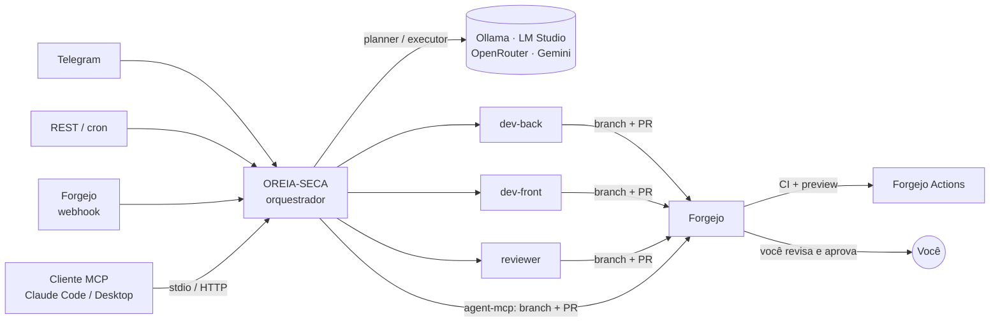

#  O.R.E.I.A.S.E.C.A

**Orquestrador de Recursos e Experimentos em IA para Sistemas de Execução e Controle Automatizado**
Orquestrador de agentes de IA que trabalham como um time de devs, em Rust.
Cada agente é uma conta no seu Forgejo: pega uma issue, trabalha num branch,
abre o pull request e espera **você** aprovar. Você acompanha e decide pelo
Telegram. O LLM é sempre externo (outra máquina, LM Studio, OpenRouter...) —
veja [Modelos locais](docs/modelos-locais.md).

Por baixo: um roteador de modelos por papel, uma fila de tarefas, aprovação
humana por qualquer canal, skills em Markdown e o ciclo issue → PR no Forgejo.



## Como funciona, em uma issue

1. Você cria uma issue no Forgejo com a label `agent:back`.
2. O Forgejo avisa o OREIA (webhook assinado). No Telegram aparece: *"Issue #12 atribuída a dev-back"*.
3. O modelo **planner** quebra a issue em fases; o agente clona o repositório num branch `agent/dev-back/issue-12`.
4. O modelo do agente executa as fases: lê código, escreve arquivos, roda testes (ações `shell`, `file_read`, `file_write` e skills).
5. O OREIA faz commit e push **com a conta do agente** e abre o PR com `Closes #12`.
6. O CI roda; você revisa (no Forgejo ou no [px0](https://github.com/px0-ai/px0)) e responde pelo Telegram:
   `/merge 7` para integrar, ou `/changes 7 faltou validar o e-mail` para o agente voltar ao PR.

O `main` fica protegido: agente nenhum faz push direto, e o merge exige a sua aprovação.

## Começando

Você só precisa do **Docker** (e, no Windows, do Git for Windows — que você já
tem se clonou o projeto). Um comando instala tudo:

```bash
./oreia install        # Linux, Mac, WSL, Git Bash
oreia.cmd install      # Windows (cmd ou PowerShell)
```

Ele faz quatro perguntas numa tela guiada — de onde vem o modelo de IA, qual
modelo, o nome do seu repositório e (opcional) o bot do Telegram — e depois
sobe o Forgejo, cria as contas e o repositório e liga os agentes. No final
mostra os endereços e a sua senha. Você não edita `.env` nem `.toml` na mão.

Depois disso, o dia a dia é um comando só:

```bash
./oreia                # painel no terminal: status, saúde dos serviços, uso e configuração
```

```
 OREIA-SECA   ● 6/7 serviços no ar  ·  fila: 1 rodando, 2 na espera  ·  atualizado 14:03:11
┌──────────────────┐┌ Saúde dos serviços ──────────────────────────────────────────────────┐
│PAINEL            ││  Serviço       Latência  Histórico      No ar  Detalhe               │
│ ● Status         ││● Orquestrador  4 ms      ▂▂▂▂▂▂▂▂▂▂     100%   localhost:3120        │
│ ♥ Saúde          ││● Forgejo       12 ms     ▂▃▃▅▃▂▂▃▂▂     100%   localhost:3000        │
│ ▤ Uso            ││● LLM · código  140 ms    ▃▄▃▆▃▃▄▃▃▅     100%   qwen2.5-coder:14b     │
│                  ││● Telegram      310 ms    ▅▅▆▅▅█▅▅▅▅     100%   @meu_bot              │
│CONFIGURAR        ││✖ px0           —         ×××××××××      0%     sem resposta          │
```

Para ver os agentes trabalhando: abra `http://localhost:3000`, crie uma issue
no seu repositório com a label `agent:back` e acompanhe pelo painel ou pelo
Telegram.

| | |
|---|---|
| Instalar sem perguntas (script, CI, agente de IA) | `./oreia install --answers setup.answers.toml` |
| Subir · parar | `./oreia up` · `./oreia down` |
| Algo não subiu? | `./oreia doctor` e [Solução de problemas](docs/problemas.md) |
| Todos os comandos | `./oreia help` |

Guia completo em [Instalação](docs/instalacao.md); o painel em detalhe em
[Painel](docs/painel.md).

## Comandos (Telegram, terminal ou `POST /api/message`)

| Comando | O que faz |
|---|---|
| texto livre | conversa direta, ou vira tarefa planejada se for um pedido de construção |
| `/feature <descrição>` | cria uma tarefa sem passar pelo classificador |
| `/issue [dono/repo] <título>` | abre uma issue no Forgejo (passo a passo se vier sem nada) |
| `/assign [dono/repo] <n> <agente>` | atribui uma issue aberta a um agente |
| `/status` · `/queue` · `/tasks` | fila, tarefas em execução e suas últimas tarefas |
| `/approve <id>` · `/reject <id>` · `/pending` | aprovação de tarefas vindas de REST/cron |
| `/retry <id>` | retoma uma tarefa interrompida |
| `/prs` | PRs abertos aguardando você |
| `/merge [dono/repo] <n>` | aprova e integra o PR |
| `/changes [dono/repo] <n> <texto>` | pede ajustes e coloca o agente de volta no PR |
| `/models` · `/agents` | modelo ativo por papel e estado dos agentes |
| `/check` | checa modelos, executores, Forgejo, tokens e Telegram da config atual |
| `/stats [papel]` | estatísticas de escalada: degraus, custo total e médio |
| `/skills [reload]` | ações disponíveis; recarrega as skills sem reiniciar |
| `/resumir` · `/limpar` | compacta ou apaga o histórico da conversa |

No Forgejo, comentar `@agent-back <pedido>` numa issue ou num PR do agente também o faz voltar ao trabalho.

## Estrutura

```
crates/
  oreia-core/      tarefas, fila, aprovação, classificador, parser de <action>, skills, armazenamento
  oreia-llm/       provedor OpenAI-compatível + roteador por papel com reserva e cooldown
  oreia-forgejo/   cliente da API e webhooks (assinatura HMAC)
  oreia-channels/  Telegram (long polling, sem framework) e terminal
  oreia-seca/      binário: config, planner, executor/escalada, git, HTTP, comandos
  oreia-mcp/       servidor MCP (P.O. por IA + desenvolvedor sob demanda) — ver docs/mcp.md
agents/            instruções de cada agente (AGENT.md)
skills/            skills em Markdown com bloco ```sh
scripts/           bootstrap do Forgejo
oreia · oreia.cmd  ponto de entrada: instalar, painel, subir/parar (Linux/Mac · Windows)
templates/app-repo CI e preview para o repositório do SEU sistema
docs/              arquitetura, configuração, agentes, segurança, modelos locais, MCP, roadmap
```

## Servidor MCP

Além da via automática acima, um cliente MCP (Claude Code, Claude Desktop...) pode
atuar como P.O. (criar/revisar histórias) ou assumir uma issue e codificá-la com o
modelo do PRÓPRIO cliente — o OREIA cuida só de git, checks e PR. As duas vias nunca
disputam a mesma issue. Desligado por padrão (comentado em `[mcp]`); veja
[Servidor MCP](docs/mcp.md).

## Desenvolvimento

```bash
cargo test --workspace      # issue → PR, escalada, setup e as telas do painel, com Forgejo simulado e git real
make lint                   # fmt + clippy -D warnings
cargo run -p oreia-seca -- --check --config oreia-seca.example.toml
```

## Documentação

- [Instalação](docs/instalacao.md): requisitos por sistema, o passo a passo de `./oreia install`, a instalação automatizada e como recomeçar do zero
- [Painel](docs/painel.md): a tela do terminal — status, saúde e latência de cada serviço, uso de tokens e custo, e as áreas de configuração
- [Solução de problemas](docs/problemas.md): o que fazer quando algo não instala, não sobe ou não responde
- [Arquitetura](docs/arquitetura.md): componentes e o caminho de uma mensagem
- [Configuração](docs/configuracao.md): `oreia-seca.toml` e `.env` campo a campo
- [Agentes](docs/agentes.md): como criar um agente novo e como eles se coordenam
- [Executores e escalada](docs/executores.md): `builtin` vs. CLIs externas e a escada de escalada por papel
- [Modelos locais](docs/modelos-locais.md): Ollama, LM Studio, llama.cpp e estratégia híbrida
- [Benchmark de hardware](docs/benchmark.md): mede CPU/RAM reais com `docker stats` em repouso e durante tarefas, cruzando com `data/escalation.jsonl`
- [Servidor MCP](docs/mcp.md): P.O. por IA e desenvolvedor sob demanda — como registrar no Claude Code/Desktop, as duas vias de trabalho e as regras de posse
- [px0 (revisão de PR)](docs/px0.md): abra `localhost:7777`, entre com login único via Forgejo, clique "Revisar" no PR que quiser e aprove/mescle direto ali
- [Segurança](docs/seguranca.md): o que protege o quê
- [Vindo do OREIA-SECA](docs/vindo-do-oreia-seca.md): o que mudou e por quê
- [Roadmap](docs/roadmap.md): o que já funciona e os próximos passos
