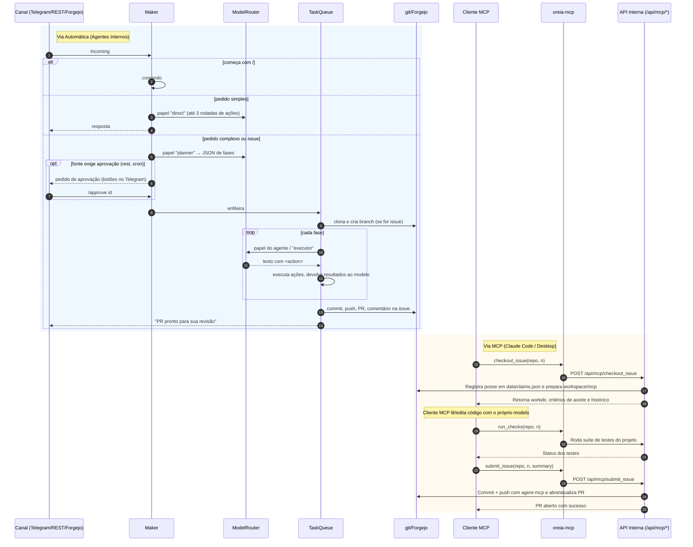

# Arquitetura

## Componentes

| Peça | Papel |
|---|---|
| **Forgejo** | Onde o trabalho acontece: issues, branches, PRs, revisão. Cada agente é um usuário. |
| **OREIA-SECA** | Orquestrador: recebe eventos e mensagens, planeja, executa, publica PRs. |
| **Ollama / LM Studio / API** | Modelos. O OREIA-SECA fala com qualquer servidor `/v1/chat/completions`. |
| **Telegram** | Seu painel de controle remoto: acompanhar, aprovar, pedir ajustes, integrar. |
| **Forgejo Actions** | CI e previews nos PRs (perfil `ci`). |
| **Servidor MCP** | Integração com Claude Code, Claude Desktop e Cursor para P.O. por IA e dev sob demanda. |

## Crates

```
oreia-core ◄── oreia-llm
    ▲   ▲           ▲
    │   └── oreia-channels
    │               ▲
oreia-forgejo       │
    ▲               │
    └──── oreia-seca (binário) ──── oreia-mcp
```

- **oreia-core** não sabe nada de rede: tipos (`Task`, `Phase`, `Incoming`, `WorkItem`), `TaskQueue`, `ApprovalBroker`, classificador de intenção, parser de `<action>`, `ActionRegistry` com `shell`/`file_read`/`file_write`, skills em Markdown, `TaskStore` e `SessionStore`.
- **oreia-llm**: `OpenAiCompat` e `ModelRouter`.
- **oreia-forgejo**: `ForgejoClient` e `webhook` (HMAC, parsing de eventos).
- **oreia-channels**: trait `Channel`, `Telegram`, `Terminal`.
- **oreia-mcp**: servidor MCP oficial (baseado em `rmcp` 3.8.0), expondo 11 ferramentas para P.O. e desenvolvedor sob demanda via stdio ou HTTP streamable, falando com a API interna do orquestrador.
- **oreia-seca**: junta tudo. `maker/` é o orquestrador, expõe a API HTTP interna (`/api/*` e `/api/mcp/*`), o painel/assistente do terminal (`setup/tui/`: assistente de primeira instalação, monitor em segundo plano de containers, saúde e uso, e as áreas de configuração — veja [Painel](painel.md)) e os comandos CLI.

## Duas vias de trabalho

O OREIA opera em duas vias que se complementam, mas nunca disputam a mesma issue ao mesmo tempo:

1. **Via Automática (já existia)**:
   - Acionada por eventos do Forgejo (label `agent:*`), comandos no Telegram ou mensagens REST.
   - O orquestrador planeja as fases e aciona os modelos configurados em `[roles]`.
   - O código é gerado pelo modelo do agente, com commits e PRs publicados usando a conta daquele agente (`agent/dev-back/...`).
2. **Via MCP (P.O. + Dev sob demanda)**:
   - Acionada por um cliente MCP externo (Claude Code, Claude Desktop, Cursor).
   - Quem "pensa" e escreve o código é o **modelo do próprio cliente** (ex.: Claude 3.7 Sonnet).
   - O OREIA cuida de git, testes (`run_checks`), branches e PRs através da conta de sistema `agent-mcp`.
   - O cliente pode criar histórias estruturadas (`create_story`), listar backlog (`list_stories`), revisar PRs (`review_pr`) ou assumir issues pendentes (`checkout_issue` → `submit_issue`).



## Decisões

- **Uma fila, concorrência configurável.** Com modelo local, rodar duas tarefas ao mesmo tempo normalmente só divide a GPU. Comece com `concurrency = 1`.
- **Posse persistente e exclusiva (`data/claims.json`).** Uma issue só tem um dono por vez: um agente automático **ou** o MCP (`claimed:mcp`), nunca os dois. Se um cliente MCP assume uma issue, o webhook da via automática a ignora. A posse sobrevive a reinicializações.
- **Loop agêntico curto por fase** (`max_steps`). O original fazia uma chamada por fase; aqui o modelo vê o resultado das ações e pode corrigir (ex.: teste falhou → ajusta), com limite para não ficar em loop.
- **Git fica com o orquestrador, não com o modelo.** O modelo edita arquivos e roda comandos; quem faz commit/push/PR é o OREIA, com o token do agente (ou com `agent-mcp` na via MCP). Isso mantém os tokens fora do alcance dos modelos e garante PRs consistentes.
- **Um branch por issue por agente** (`agent/<nome>/issue-<n>`). Pedidos de ajuste continuam no mesmo branch e atualizam o mesmo PR.
- **Sem banco de dados.** Tarefas em JSON (`data/tasks/`), sessões em `data/sessions.json`, posse em `data/claims.json`. Fácil de inspecionar e fazer backup.
