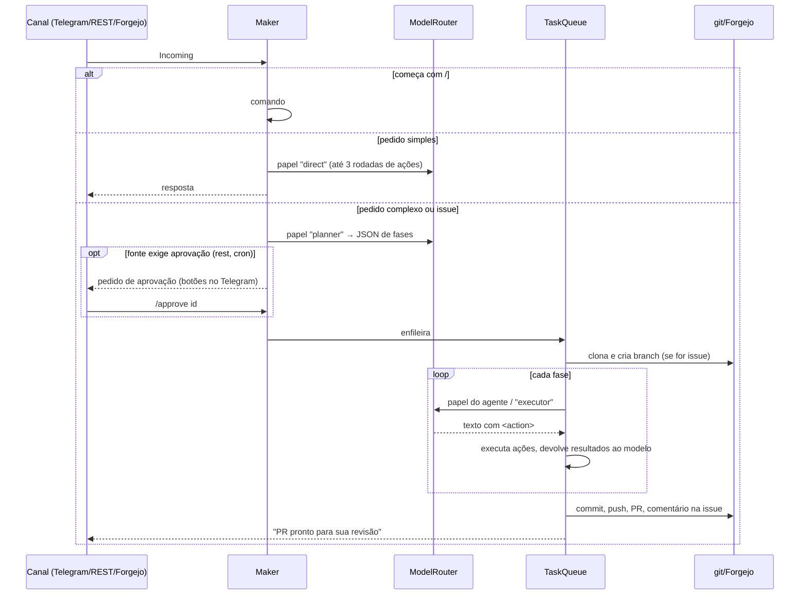

# Arquitetura

## Componentes

| Peça | Papel |
|---|---|
| **Forgejo** | Onde o trabalho acontece: issues, branches, PRs, revisão. Cada agente é um usuário. |
| **OREIA-SECA** | Orquestrador: recebe eventos e mensagens, planeja, executa, publica PRs. |
| **Ollama / LM Studio / API** | Modelos. O OREIA-SECA fala com qualquer servidor `/v1/chat/completions`. |
| **Telegram** | Seu painel de controle remoto: acompanhar, aprovar, pedir ajustes, integrar. |
| **Forgejo Actions** | CI e previews nos PRs (perfil `ci`). |

## Crates

```
oreia-core ◄── oreia-llm
    ▲   ▲           ▲
    │   └── oreia-channels
    │               ▲
oreia-forgejo       │
    ▲               │
    └──── oreia-seca (binário) ────┘
```

- **oreia-core** não sabe nada de rede: tipos (`Task`, `Phase`, `Incoming`, `WorkItem`), `TaskQueue`, `ApprovalBroker`, classificador de intenção, parser de `<action>`, `ActionRegistry` com `shell`/`file_read`/`file_write`, skills em Markdown, `TaskStore` e `SessionStore`.
- **oreia-llm**: `OpenAiCompat` e `ModelRouter`.
- **oreia-forgejo**: `ForgejoClient` e `webhook` (HMAC, parsing de eventos).
- **oreia-channels**: trait `Channel`, `Telegram`, `Terminal`.
- **oreia-seca**: junta tudo. `maker/` é o orquestrador.

## Caminho de uma mensagem



## Decisões

- **Uma fila, concorrência configurável.** Com modelo local, rodar duas tarefas ao mesmo tempo normalmente só divide a GPU. Comece com `concurrency = 1`.
- **Loop agêntico curto por fase** (`max_steps`). O original fazia uma chamada por fase; aqui o modelo vê o resultado das ações e pode corrigir (ex.: teste falhou → ajusta), com limite para não ficar em loop.
- **Git fica com o orquestrador, não com o modelo.** O modelo edita arquivos e roda comandos; quem faz commit/push/PR é o OREIA, com o token do agente. Isso mantém o token fora do alcance do modelo e garante PRs consistentes.
- **Um branch por issue por agente** (`agent/<nome>/issue-<n>`). Pedidos de ajuste continuam no mesmo branch e atualizam o mesmo PR.
- **Sem banco de dados.** Tarefas em JSON (`data/tasks/`), sessões em `data/sessions.json`. Fácil de inspecionar e fazer backup.
